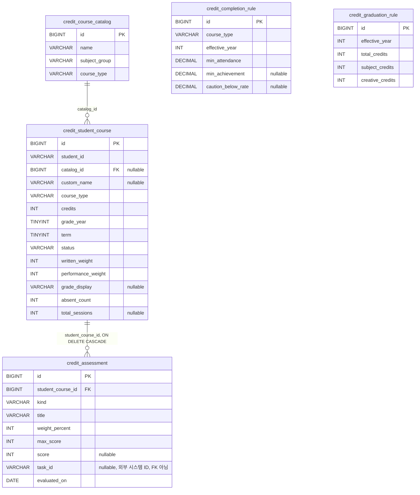

# DB ERD

기준: database/migrations/V1~V2에 적용된 실제 스키마 (V3~V5는 시딩 데이터라 테이블 구조에 영향 없음).
계산값(성취율, 이수 상태, 출석률)은 저장하지 않는다 — CLAUDE.md 규칙.

## 참고
- `credit_completion_rule`, `credit_graduation_rule`은 다른 테이블과 FK 관계가 없는 독립 설정 테이블이다. `course_type`/`effective_year` 값으로 서비스 로직에서 참조한다.
- `credit_student_course.catalog_id`는 nullable이다 — 표준 과목 목록에 없는 과목(직접 입력, `custom_name`)을 등록할 수 있다.
- `credit_assessment.task_id`는 기존 수행평가 시스템 연결용 문자열이며 FK가 아니다(다른 시스템 소유, V1 주석 참고). 이번 범위에서는 항상 비워 둔다.
- course_type 허용값(V2 기준): COMMON, GENERAL, CAREER, FUSION, CREATIVE, SPECIALIZED.
